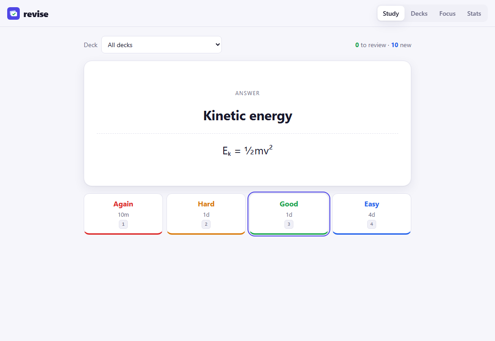

# revise


Flashcards with spaced repetition, plus a focus timer, for revising A-levels. It works offline, needs no account, and keeps your data on your own device.

**[Open revise](https://jhleez1.github.io/revise/)** (on a phone you can "Add to Home Screen" and it works like an app)



## Why

I wanted something between a paper flashcard and Anki: quick to open on my phone between lessons, no sign-up, and with a timer built in so revision happens in focused blocks.

## Features

- **Spaced repetition:** after each card you choose Again, Hard, Good or Easy, and the app decides when you see it next. Each button shows how long that will be. Cards you know come back less and less often.
- **Decks:** add cards one at a time, or paste a whole list (`front;back` per line, or two columns copied from a spreadsheet). Search, delete, rename and export to CSV.
- **Focus timer:** 25-minute focus blocks and 5-minute breaks, both adjustable, with a sound when time is up. The time shows in the browser tab.
- **Stats:** day streak, reviews today, how many cards you remembered, a 30-day chart and cards by stage (new, learning, young, mature).
- **Starter decks:** A-level Physics equations and A-level Computer Science key terms.
- **Keyboard:** `Space` shows the answer, `1`–`4` grade it.
- **Offline and private:** a service worker caches the app, and data is stored in `localStorage`. Export a backup file to move it to another device.
- **Light and dark mode** follow your system setting.

## How the scheduling works

`srs.js` is a simplified version of SM-2, the algorithm behind SuperMemo and Anki.

- Every card has an **interval** (days until it's due) and an **ease** (starts at 2.5).
- **Good** multiplies the interval by the ease: 1 → 3 → 8 → 20 → 50 days…
- **Easy** multiplies it a bit more and raises the ease. **Hard** grows it only slightly and lowers the ease.
- **Again** resets the card. It comes back in 10 minutes, and its ease drops by 0.2 (never below 1.3), so a hard card stays frequent.
- Intervals are capped at a year. New cards are limited to 20 a day, so reviews don't pile up.

## Files

| File | What it is |
| --- | --- |
| `index.html`, `style.css`, `app.js` | The app |
| `srs.js` | Scheduler (no browser code, so it can be tested in Node) |
| `samples.js` | Starter decks |
| `sw.js`, `manifest.webmanifest`, `icon.svg` | Offline support and install |
| `test/srs.test.js` | Tests for the scheduler |

## Run it

Open `index.html` in a browser. Offline mode needs it served over HTTP, for example with `python -m http.server`, or from GitHub Pages.

Tests need Node 18 or newer:

```
node --test
```

---

Built by [Jihan Lee](https://github.com/jhleez1), with help from Claude (AI).
